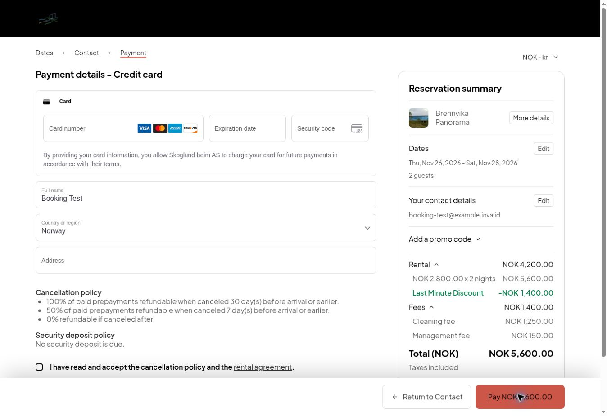

# Bestillingskontroll 20. november 2026

Testen ble kjørt mot den publiserte [norske](https://preview.brennvik-panorama.pages.dev/bestill/) og [engelske](https://preview.brennvik-panorama.pages.dev/en/book/) forhåndsvisningen i Chrome på skrivebord. Vi leste pris og oppholdsdetaljer i begge ender av bestillingen. Utleieobjektet hos Lodgify var Brennvika Panorama, ID 828625. Filen `/booking.js` fra forhåndsvisningen var byteidentisk med Git-blob `c9922cf85edd7bf9b9c7c66d89222800559a49e3` på utgangsgrenen.

| Inngang | Opphold i november 2026 | Voksne | Pris i modulen | Pris hos Lodgify | Siste kontrollerte steg |
|---|---|---:|---:|---:|---|
| Norsk, «Fortsett til bestilling» | 26.–28., 2 netter | 2 | 5 600 kr | 5 600 NOK | Betalingsskjema med kortfelt og knappen «Pay NOK 5,600.00» |
| Engelsk, «Open booking in a new window» | 26.–29., 3 netter | 4 | 8 645 kr | 8 645 NOK | Kontaktskjema med bestillingsoppsummering |
| Endret fra fire til to voksne i både modulen og Lodgifys eget datosteg | 26.–29., 3 netter | 2 | 8 645 kr | 8 645 NOK | Kontaktskjema med to gjester |

For to netter var leien 5 600 kr før siste liten-rabatt på 1 400 kr. Rengjøring kostet 1 250 kr og administrasjon 150 kr. For tre netter var leien 9 520 kr før rabatt på 2 380 kr. Rengjøring kostet 1 250 kr og administrasjon 255 kr. Begge totalsummene inkluderte skatt. Dette er observerte tilbud for de valgte datoene.

På det norske løpet brukte vi fiktive kontaktopplysninger for å se siste steg. Stripe viste live-modus, tomme kortfelt og 5 600 NOK. Avkryssingen for avbestillingsvilkår og leieavtale var tom da vi stoppet. Vi trykket aldri på betalingsknappen. Ingen reservasjon eller betaling ble gjennomført.



## Vurdering av septemberfeilen

Modulen fortsatte å vise både datoer og pris i begge løpene. Feilen `Cannot read properties of undefined (reading 'title')` forekom ikke i de kontrollerte nettleserloggene. Lodgifys eget datosteg godtok også endring i gjesteantall og viste samme total som forhåndsvisningen.

Septemberloggen plasserte unntaket i leverandørskriptet. Nettsidens eget skript tilpasser lenker og håndterer bortfall av modulen. Lodgify beregner prisen. Vi har verken septemberversjonen av leverandørskriptet med tilhørende prisrespons eller en feilende kjøring nå. En separat live-kjøring av bare den innbygde modulen uten nettsidens skript ble ikke verifisert. Historisk årsak, herunder om nettsidens konfigurasjon utløste feilen, er fortsatt uavklart.

## Repeterbare tester

Fra `website/source` med Node 22 eller nyere:

```sh
npm ci
npm test
npx playwright install chromium
npm run test:live -- 2026-11-26 2026-11-28 2
```

Bruk nye, ledige datoer ved senere kjøringer. Live-testen bruker norsk bestillingsknapp og engelsk direktelenke. Den velger opphold i kalenderen, åpner den faktiske knappen og kontrollerer hytte, ankomst, avreise, antall gjester, valuta og at leie etter rabatter pluss gebyrer er lik totalen. Den sammenligner denne totalen med prisen som vises i modulen. Testen stopper på kontaktsiden. Betalingssteget ovenfor ble kontrollert separat.

- `npm test` ga 4 beståtte tester og 0 feil. Én dekker eksisterende lenkesjekker. Tre tester kjører nettsidens faktiske skript i en simulert DOM og kontrollerer bortfall etter valgt opphold, feil ved lasting av leverandørskriptet og gjenoppretting etter tidsavbrudd.
- Begge live-scenarioene i de to første tabellradene ble også kjørt med `booking-scenario.mjs` via testnettleseren. Resultatene var henholdsvis 4 200 + 1 400 = 5 600 NOK og 7 140 + 1 505 = 8 645 NOK. Den frittstående Playwright-startkommandoen ble syntakskontrollert. Den lokale nettleseren kunne ikke startes i arbeidsmiljøet.
- Før domenebytte gjenstår en kontroll på fysisk mobil av kalender, gjesteteller, pris, vindusskifte og siste oppsummering. Kontroller deretter produksjonsadressene og søkemotorinnstillingene som er beskrevet i publiseringsveiledningen. Det er ikke publisert noen ny versjon.
